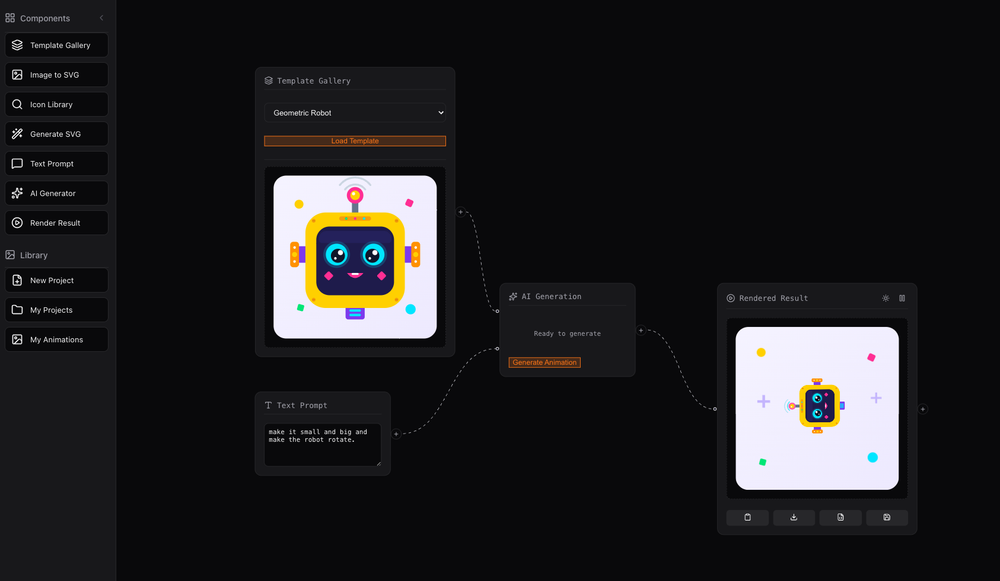

# SVG Animator No-Code

A visual node editor that animates SVGs in the browser. You drag nodes onto a canvas, wire an SVG to a text prompt, and an AI model writes the CSS keyframes or SMIL animation that does what you described. The finished SVG can be copied out, downloaded, or exported as an inline React component.



## What it does

Everything runs on a single canvas with four kinds of node: a **source** that provides an SVG, a **Text Prompt** that describes the motion, the **AI Generation** node that turns one into the other, and a **Rendered Result** that plays the output.

Sources are interchangeable:

| Node | Gets an SVG from |
|---|---|
| **Template Gallery** | Six built-in starting points: spinner, hamburger icon, play button, weather scene, bouncing ball, geometric robot |
| **Image to SVG** | An uploaded raster image, traced into vector paths |
| **Icon Library** | A text query, answered with a 24×24 stroke icon in a Lucide-style aesthetic |
| **Generate SVG** | A text description of a static illustration |
| **SVG Source** | Raw SVG pasted in directly |

The prompt node takes plain English. In the screenshot above it reads *"make it small and big and make the robot rotate"*, which is the whole interface: no keyframe editor, no easing curves, no timeline.

The AI node has two modes. In normal mode it takes one SVG and animates it. In **morph mode** it takes a before SVG and an after SVG and produces a single shape that transitions between them.

## Exporting

The Rendered Result node has four actions:

- **Copy SVG**: the animated SVG markup, straight to the clipboard
- **Download**: as `animated-design.svg`, animation and all
- **Copy React**: a ready-to-paste `AnimatedIcon` component, with `class` rewritten to `className` and inline styles converted to React style objects
- **Save to gallery**: stores the result in your account under My Animations

There's also a play/pause toggle that suspends the animation by flipping `animation-play-state` on the SVG and every descendant element, so SMIL and CSS animations both stop cleanly.

## Projects

Save from the canvas and the database stores the full React Flow graph: every node's position, its data, the prompt text, the SVG contents, and the edges between them. Reopening a project restores the canvas exactly as you left it, wiring included. Saving over an existing project updates it instead of creating a duplicate.

Authentication is Google OAuth via NextAuth, and anything stored is scoped to your account.

## AI model

The only supported provider is **Google Gemini**, through the `@google/genai` SDK. The model is **`gemini-3.8-flash`**, set in `src/app/api/animate/route.ts`.

OpenAI, Anthropic and local models are not wired up. `docs/FUTURE_ENHANCEMENT_CHARACTER_ANIMATION.md` describes a model selector that would let you pick between them; it doesn't exist yet.

Thinking is set to `medium`. From Gemini 3.6 onward the old sampling parameters (`temperature`, `top_p`, `top_k`) are deprecated and rejected, so output stability has to come from the system instructions.

You can point the app at a different Gemini model without editing code:

```env
GEMINI_MODEL="gemini-3.6-flash"
```

Leave it unset and you get `gemini-3.8-flash`.

## Running it locally

Short version: you need Node 18+, a PostgreSQL database, a Google OAuth client, and a Gemini API key:

```bash
git clone https://github.com/amrsingh29/svg-animator-no-code.git
cd svg-animator-no-code
npm install
# create .env with DATABASE_URL, NEXTAUTH_SECRET, NEXTAUTH_URL,
# GOOGLE_CLIENT_ID, GOOGLE_CLIENT_SECRET, GEMINI_API_KEY
npx prisma generate && npx prisma db push
npm run dev
```

The app runs on **http://localhost:3001**. `npm run dev` passes `-p 3001` explicitly, so it is not on the default 3000.

**→ [Local deployment guide](docs/local-deployment-guide.md)** has the full walkthrough: environment variables, PostgreSQL setup, creating the Google OAuth client, and getting a Gemini API key.

## Tech stack

Next.js 16 (App Router, Turbopack) · React 19 · React Flow via `@xyflow/react` · Prisma 5 on PostgreSQL · NextAuth with the Prisma adapter · `@google/genai` · framer-motion · lucide-react

## Roadmap

Tracked as issues and in `docs/`:

- `docs/ISSUE_BODY.md`: granular transform nodes, sequence and delay nodes, hover/click triggers, Lottie and GIF/MP4 export, SVG layer splitting, a public gallery, and an SVGO optimiser node
- `docs/FUTURE_ENHANCEMENT_CHARACTER_ANIMATION.md`: the longer arc toward a character animation platform
- `docs/IMAGE_COMBINATION_WORKFLOW_ISSUE.md`: combining multiple source images in one workflow

## Status

A working prototype, not a product. The core loop works: AI turns a prompt into a valid, scope-isolated animated SVG, and canvas state survives a save/load round trip. There is no test suite, and `npm audit` reports vulnerable transitive dependencies.

Built with Next.js, React Flow, Prisma, and ❤️
